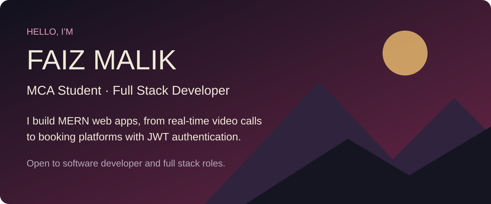
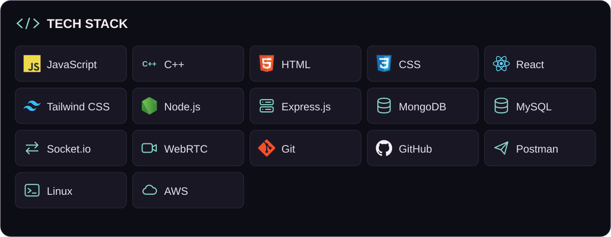

**Faiz Malik** · MCA Student & Full Stack Developer · DSA in C++

I'm an MCA student and full stack developer who builds MERN web apps, from real-time video calls using WebRTC and Socket.io to booking platforms with JWT authentication. I recently completed a full stack internship and I'm looking for software developer or full stack roles.

[LinkedIn](https://linkedin.com/in/faizmalikdev) · [Email](mailto:faizmalik93320@gmail.com)

## ⚡ Tech Stack

<picture>
  <source media="(max-width:640px)" srcset="assets/tech-stack-mobile.svg">
  
</picture>

**Also used:** Vite, MUI, REST APIs, JWT, Cloudinary and MapTiler.

## 🚀 Featured Projects

### 📹 Video Conferencing App

A real-time video conferencing application inspired by platforms like Zoom.

**Tech:** React.js • Node.js • Express.js • WebRTC • Socket.io

[Source](https://github.com/faizmalikdev/syncmeet-app) · [Live demo](https://syncmeet-frontend-iby8.onrender.com/)

✨ Features:

- 🎥 Real-time video calling
- 🎙️ Audio & microphone controls
- 🖥️ Screen sharing
- 💬 Real-time chat
- 📞 End call functionality
- 👥 Multiple-user communication
- 🔄 Real-time signaling using Socket.io

---

### 🏠 Airnest — Airbnb Clone

A full-stack accommodation platform inspired by Airbnb.

**Tech:** MERN Stack • MongoDB • Express.js • React.js • Node.js

[Source](https://github.com/faizmalikdev/Airnest-airbnb-) · [Live demo](https://airnest-airbnb.onrender.com/)

✨ Features:

- 🏡 Property listings
- 🔐 User authentication
- 📍 Location & map integration
- ☁️ Cloudinary image uploads
- 🗺️ MapTiler geocoding
- 📱 Responsive UI
- 🔑 JWT-based authentication

---

### 🎓 Learning Management System

A MERN Stack-based LMS developed as a final-year project.

**Tech:** React.js • Node.js • Express.js • MongoDB

Built to manage learning content and provide an organized platform for students and instructors.

---

## 📚 Currently Learning

```text
DSA in C++
        ↓
Advanced React.js
        ↓
Backend & REST APIs
        ↓
System Design
        ↓
DevOps & Cloud
```

I'm continuously improving my problem-solving skills while building full-stack applications.

---

## 🎯 2026 Goals

✅ Strengthen MERN Stack Development

✅ Master DSA using C++

✅ Build more production-ready projects

✅ Improve Backend & System Design skills

✅ Learn DevOps & Cloud technologies

✅ Contribute to Open Source

✅ Become a job-ready Full Stack Developer

---

## 👨‍💻 About Me

- **Studying:** MCA at Mangalayatan University (2025 to present). BCA at Dr. MPS Group of Institutions, College of Business Studies (2022 to 2025).
- **Experience:** Full Stack Web Development Intern at the International Institute of SDGs and Public Policy Research (May to July 2026), building React components and connecting them to backend APIs.


## 🌐 Connect With Me

<p align="left">

<a href="https://github.com/faizmalikdev" target="_blank">

</a>

<a href="https://linkedin.com/in/faizmalikdev" target="_blank">

</a>

<a href="https://faizmalik93320@gmail.com" target="_blank">

</a>

</p>


---

<p align="center">
  💡 <b>"Code. Build. Learn. Repeat."</b>
</p>

<p align="center">
  ⭐ If you find my projects useful, consider giving them a star!
</p>


